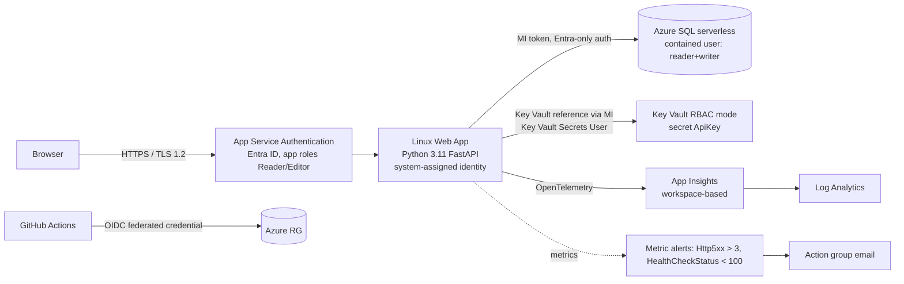

# azure-01-secure-webapp v2: Terraform + GitHub Actions (OIDC)

v2 of the secure web app. v1 built the stack by hand with `az` CLI; in v2 the whole stack is defined in **Terraform** and deployed by **GitHub Actions**. The pipeline signs in with **OIDC federated credentials** (no client secrets anywhere), runs IaC scanning, and needs a person to approve the plan before apply.

> **Validation status (be precise about this in interviews)**
> Checks below were run in a Linux sandbox on 2026-11-12. **Nothing has been deployed to Azure.** No `terraform plan` against a real subscription, no `apply`, and no GitHub Actions run has happened yet.
>
> | Check | Result |
> |---|---|
> | `terraform fmt -check -recursive` (Terraform 1.9.8) | passed |
> | `terraform init -backend=false && terraform validate` (azurerm 4.81.0, azuread 3.10.0, random 3.9.1, time 0.14.2) | passed, 0 warnings |
> | `terraform test` (4 offline plan tests with **mocked** providers: existing RG, sandbox toggles off, RG creation, input validation) | 4/4 passed |
> | `tflint --recursive` (tflint 0.66.0, azurerm ruleset 0.27.0) | passed, 0 issues |
> | `checkov -d infra --framework terraform` (Checkov 3.4.5) | 22 passed, 0 failed, 20 skipped (each skip has an inline justification, listed under [Accepted risks](#accepted-risks-checkov-skips)) |
> | `actionlint` on both workflows, `shellcheck` / `bash -n` on scripts | passed |
> | `LOCAL_DEV=1 pytest -q` (Python 3.11) | 5/5 passed |
> | Real `terraform plan/apply`, Easy Auth sign-in, Key Vault reference, SQL grant script, bootstrap scripts, workflows on GitHub | **not executed** |
>
> The mocked tests show the wiring and toggles evaluate correctly. They do **not** show that Azure accepts every setting: only a real apply can show that.

---

## Architecture



Same app and security design as v1 (see the v1 guide, `../BUILD_GUIDE_full.md`). Only the delivery method is new.

## Repository layout / module map

```
infra/                         Terraform root module
  versions.tf                  providers: azurerm ~>4.0, azuread ~>3.0, random, time
  backend.tf                   azurerm remote state (partial config)
  main.tf  variables.tf  outputs.tf
  envs/dev.tfvars              KodeKloud sandbox values (no secrets)
  envs/prod.tfvars.example     production-style example
  envs/dev.backend.hcl         backend values for local init
  backend_override.tf.example  local state fallback for sandboxes
  tests/plan.tftest.hcl        offline plan tests (mocked providers)
  .tflint.hcl
  modules/
    monitoring/   Log Analytics + workspace-based App Insights
    auth/         Entra app registration (Reader/Editor app roles, redirect URI,
                  ID-token flow, no client secret), service principal, role members
    keyvault/     Key Vault (RBAC mode, soft delete, purge protection toggle),
                  Secrets Officer for deployer, ApiKey secret, diagnostic logs
    sql/          SQL server (Entra-only admin, TLS 1.2), serverless DB,
                  AllowAzureServices rule, optional client IPs, auditing -> LAW
    appservice/   Linux plan + web app (identity, https_only, TLS 1.2, FTPS off,
                  basic-auth publishing off, /health, startup command, app settings,
                  auth_settings_v2 with Entra), diagnostic logs
    rbac/         Key Vault Secrets User for the web app identity (vault scope)
    alerts/       action group, Http5xx + HealthCheckStatus alerts, optional CPU alert
app/ tests/ sql/schema.sql requirements.txt startup.sh pytest.ini   app code (from v1)
scripts/
  bootstrap-tfstate.sh   create the state storage account (one time)
  bootstrap-oidc.sh      create the GitHub deployer identity + federated credentials
  grant-sql-access.sh    post-deploy: schema + contained user for the web app identity
.github/workflows/
  infra.yml   PR: fmt, validate, test, tflint, Checkov, plan (artifact + PR comment)
              main: apply of the reviewed plan, gated by Environment "production"
  app.yml     pytest, then zip deploy with OIDC + /health smoke test
```

### What each v1 manual step became

| v1 (az CLI / portal) | v2 |
|---|---|
| `az sql server create --enable-ad-only-auth` | `module.sql` `azuread_administrator { azuread_authentication_only = true }` |
| `az webapp create/update/config set` | `module.appservice` `azurerm_linux_web_app` |
| Portal: Authentication + app roles | `module.auth` (`azuread_application` app roles) + `auth_settings_v2` |
| `az keyvault create`, `role assignment`, `secret set` | `module.keyvault` + `module.rbac` |
| `az monitor ...` | `module.monitoring` + `module.alerts` |
| `CREATE USER ... FROM EXTERNAL PROVIDER` | `scripts/grant-sql-access.sh` (manual or pipeline step) |
| Publish profile secret in GitHub | OIDC federated credential, basic-auth publishing disabled |

## Security design

- **No secrets in code or in GitHub.** GitHub stores only identifiers (client ID, tenant ID, subscription ID) as repo variables. Terraform authenticates with `ARM_USE_OIDC=true`.
- **Workload identity:** the web app's system-assigned identity gets `Key Vault Secrets User` on **one vault**, plus `db_datareader` + `db_datawriter` in **one database**. No db_owner, no DDL, no management-plane rights.
- **Deployer identity (least privilege for a sandbox RG):** `Contributor` on the resource group only, not the subscription. It also gets `Role Based Access Control Administrator` with an **ABAC condition**, so it can only assign or remove `Key Vault Secrets User` and `Key Vault Secrets Officer`. That replaces Owner / User Access Administrator. It also gets `Storage Blob Data Contributor` on the state account.
- **Easy Auth without a client secret:** the app registration uses the ID-token flow, so there is no secret to store, rotate, or leak through state. Trade-off: the app gets an ID token only, no access token for downstream APIs. To call Graph later, add a secret stored in Key Vault, or use a federated credential.
- **Authentication vs authorization:** Easy Auth answers "who are you". The app checks the app-role claims and returns 403 when the role is missing. `/health` is excluded from auth so the health probe and alert work. `app_role_assignment_required` defaults to `false` so the app's own 403 can be demonstrated.
- **Entra-only SQL:** no SQL login or password exists at all.
- **Transport:** HTTPS only, TLS 1.2 minimum (web, SCM, SQL), FTPS disabled, HTTP/2 on.
- **Pipeline guardrails:** `permissions: {}` by default and per-job least privilege. Checkov fails the PR on any finding that has no justification. Apply uses the **exact reviewed plan file** and runs only after a reviewer approves the `production` environment. A concurrency group allows one Terraform run at a time.

## Run it locally (Git Bash on Windows)

> Git Bash rewrites arguments that start with `/` (such as `/subscriptions/...` resource IDs) into Windows paths, which makes `az` fail with `MissingSubscription`. Run `export MSYS_NO_PATHCONV=1` in each new terminal. The scripts in `scripts/` already set it.

Prerequisites: Terraform >= 1.6 (`winget install Hashicorp.Terraform`), Azure CLI, go-sqlcmd (`winget install sqlcmd`). Optional: tflint, Checkov (`pip install checkov`).

```bash
az login                                    # KodeKloud credentials
az group list -o table                      # the pre-created resource group
export ARM_SUBSCRIPTION_ID=$(az account show --query id -o tsv)   # required by azurerm 4.x
export TF_VAR_alert_email="you@example.com" # keeps the address out of git

cd infra
# Edit envs/dev.tfvars: resource_group_name, and toggles for whatever the sandbox blocks.

# Option A: remote state (after scripts/bootstrap-tfstate.sh, fill envs/dev.backend.hcl)
terraform init -backend-config=envs/dev.backend.hcl
# Option B: short-lived sandbox, local state
cp backend_override.tf.example backend_override.tf && terraform init

terraform fmt -check -recursive && terraform validate && terraform test
terraform plan  -var-file=envs/dev.tfvars -out=tfplan
terraform apply tfplan

# Post-deploy: schema + contained SQL user (you are the Entra SQL admin by default)
MYIP=$(curl -s https://api.ipify.org)       # or set sql_client_ip_ranges in tfvars and re-apply
az sql server firewall-rule create -g "$(terraform output -raw resource_group_name)" \
  -s "$(terraform output -raw sql_server_name)" -n MyPC --start-ip-address $MYIP --end-ip-address $MYIP
../scripts/grant-sql-access.sh

# Deploy the code (same as v1)
cd .. && zip -r app.zip app requirements.txt startup.sh
az webapp deploy -g <rg> -n "$(terraform -chdir=infra output -raw web_app_name)" --src-path app.zip --type zip
curl "$(terraform -chdir=infra output -raw web_app_url)/health"
```

> On Windows `zip` may not be installed in Git Bash. In that case run `powershell Compress-Archive -Path app,requirements.txt,startup.sh -DestinationPath app.zip`.

Local app tests:

```bash
python -m venv .venv && source .venv/Scripts/activate
pip install -r requirements.txt
LOCAL_DEV=1 pytest -q
```

## Sandbox toggles (KodeKloud constraints)

| Constraint seen in the sandbox | Setting | Effect |
|---|---|---|
| Cannot create resource groups | `use_existing_resource_group = true` (default) | RG is read with a data source; Terraform never creates or deletes it |
| Cannot create app registrations | `enable_entra_auth = false` | no `azuread_*` resources, no `auth_settings_v2`; test role logic with pytest |
| Cannot create role assignments | `enable_role_assignments = false` | Key Vault RBAC assignments skipped. Also set `create_kv_secret = false` unless you already have a data-plane role. `API_KEY` then shows as an unresolved reference |
| Cannot create role assignments, but want Key Vault to work | `enable_role_assignments = false` + `kv_use_access_policies = true` | Vault switches to access-policy mode (needs only Contributor). Deployer gets secret Get/List/Set/Delete/Recover/Purge, web app identity gets Get/List. Document as a sandbox deviation: RBAC is the production choice |
| No data-plane role on the vault | `create_kv_secret = false` | vault is created, secret is set by someone who has the role |
| Alerts/action groups blocked | `enable_alerts = false` | no monitor alert resources |
| Free tier only | `app_service_sku = "F1"` | `always_on` turns off automatically |
| Resource provider registration denied | `resource_provider_registrations = "none"` (default) | provider does not try to register RPs |
| Vault name reuse after cleanup | `kv_purge_protection_enabled = false` (dev) | `terraform destroy` purges the vault. Prod example sets it to `true` |

Write down what you hit in `docs/sandbox-constraints.md`. Turning a toggle off is fine as long as the README says so.

## How the pipeline works

**One-time setup**

1. `RG=<rg> ./scripts/bootstrap-tfstate.sh` creates the state storage account: no shared keys, no public blob access, TLS 1.2, versioning + soft delete.
2. `RG=<rg> GH_REPO=<owner>/azure-01-secure-webapp TFSTATE_SA=<sa> ./scripts/bootstrap-oidc.sh` creates the deployer app registration, its service principal, federated credentials for `ref:refs/heads/main`, `pull_request` and `environment:production`, and the RG-scoped roles. **In KodeKloud this probably fails** (no app registrations or role assignments). The workflows then stay in the repo as documented but unexecuted, and you deploy from your PC.
3. GitHub: add repo **variables** `AZURE_CLIENT_ID`, `AZURE_TENANT_ID`, `AZURE_SUBSCRIPTION_ID`, `RESOURCE_GROUP`, `TFSTATE_RESOURCE_GROUP`, `TFSTATE_STORAGE_ACCOUNT`, `TFSTATE_CONTAINER`, `APP_NAME`, `ALERT_EMAIL`, and optionally `RUN_SQL_GRANT=true`. Create the Environment **production** with yourself as required reviewer.

**infra.yml**

| Trigger | Jobs |
|---|---|
| Pull request | `static-checks` (fmt, validate, `terraform test`, tflint, Checkov + SARIF upload) → `plan` (OIDC, remote state, plan uploaded as a 3-day artifact and posted as a PR comment) |
| Push to main | same checks + plan → `apply` waits for approval on Environment `production`, downloads the reviewed `tfplan`, runs `terraform apply tfplan`, then (if `RUN_SQL_GRANT=true`) opens a temporary SQL firewall rule for the runner IP, runs `grant-sql-access.sh`, and removes the rule again |

**app.yml**: on PR runs pytest only. On main it runs pytest, builds the zip, logs in with `azure/login` (OIDC), runs `azure/webapps-deploy`, then polls `/health` until it returns 200.

### The SQL contained user (why it is a script)

`CREATE USER [app] FROM EXTERNAL PROVIDER` plus `ALTER ROLE db_datareader/db_datawriter` is T-SQL inside the database. It is not an ARM resource, so azurerm cannot manage it cleanly. `scripts/grant-sql-access.sh` runs it with `sqlcmd -G` (Entra auth through your `az login` or the pipeline's OIDC session) and is safe to re-run. When it runs as a **service principal**, `FROM EXTERNAL PROVIDER` would need the SQL server to read Microsoft Graph (Directory Readers). The script therefore accepts `APP_CLIENT_ID` and uses `CREATE USER ... WITH SID = <client id>, TYPE = E`, which needs no Graph lookup. The pipeline needs its identity to be the Entra SQL admin. That is the default when Terraform runs in CI; for a team, use an Entra group (`sql_admin_object_id`).

## Terraform vs Bicep (why Terraform here)

| | Terraform | Bicep |
|---|---|---|
| Scope | Azure **and** Entra ID (azuread provider: app registration, app roles, role members) in one tool | Azure resources; Entra objects need the Graph extension (preview) or scripts |
| State | explicit state file (needs a secured backend; enables plan/drift detection across providers) | no state file; ARM is the source of truth, `what-if` for preview |
| Ecosystem | multi-cloud, tflint, Checkov, `terraform test` with mocks | first-party, day-0 support for new Azure API versions |
| Cost of choice | state management and secret-in-state risk | less portable |

For this project the deciding factor was managing the Easy Auth app registration and its app roles as code. Bicep cannot do that cleanly today.

## State security

- **Secrets end up in state.** The `ApiKey` value (from `var.api_key` or `random_password`) and the App Insights connection string are stored in plain JSON in state, and so is anything marked `sensitive`. `sensitive` only hides values in CLI output. For prod, set `create_kv_secret = false` and write the secret out of band (example in `envs/prod.tfvars.example`).
- **Backend:** Azure Blob with Entra auth only (`use_azuread_auth = true`, shared keys disabled). Access is limited to the deployer identity and admins through `Storage Blob Data Contributor` on that account.
- **Locking:** the azurerm backend takes a blob lease during plan/apply, and the workflow adds a `concurrency` group on top.
- **Encryption and recovery:** Azure Storage encrypts data at rest (Microsoft-managed keys; customer-managed keys possible). Blob versioning + soft delete allow recovery of a corrupted state.
- **Plan artifacts** can contain secrets: 3-day retention, private repo recommended, and never commit `tfplan`/`*.tfstate` (see `.gitignore`).

## Accepted risks (Checkov skips)

Every skip is an inline `#checkov:skip=<ID>:<reason>` comment, so it is visible in code review. In short:

- **Public endpoints** on Key Vault, SQL and the web app, no private endpoints (CKV_AZURE_189/109/113/222, CKV2_AZURE_32/45/34). The sandbox has no VNet. Access is gated by Entra RBAC / Entra-only auth / Easy Auth. Hardening path: VNet integration for the web app, private endpoints for SQL and Key Vault, drop the 0.0.0.0 rule, vault `default_action = "Deny"`, and self-hosted runners or a deployment environment inside the VNet.
- **Cost/availability** (CKV_AZURE_211/212/225/229/224): single B1 instance, no zone redundancy, no ledger.
- **Purge protection / recoverability** (CKV_AZURE_110/42) is variable-driven: off for the throwaway dev environment, on in the prod example.
- **Secret expiry** (CKV_AZURE_41), **SQL VA** (CKV2_AZURE_2, needs paid Defender), **audit retention** (CKV_AZURE_24: governed by Log Analytics retention), **client certificates** (CKV_AZURE_17: Entra sign-in is used), **Azure Files** (CKV_AZURE_88: stateless app), **always_on** (CKV_AZURE_214: computed, false only on Free).

## Cleanup

```bash
cd infra
terraform destroy -var-file=envs/dev.tfvars
```
The existing resource group is only read, so it is **not** deleted. With purge protection off, the vault is purged on destroy. With it on, the name stays reserved for the retention period. Delete the state storage account and the deployer app registration separately if you created them:
`az storage account delete -g <rg> -n <sa>` and `az ad app delete --id <AZURE_CLIENT_ID>`.

## Known gaps / next steps

- Real plan/apply in a sandbox and screenshots for `evidence/` (same checklist as v1).
- The web app hostname is computed as `<name>.azurewebsites.net` for the redirect URI, to avoid a dependency cycle. If "secure unique default hostname" is enforced in your tenant, update the redirect URI after the first apply.
- `startup.sh` installs ODBC 18 at container start (fragile, as noted in v1). A custom container would be the robust fix.

## How AI was used

_Template, fill in honestly:_

- **Tool(s):** e.g. Abacus AI agent / Copilot.
- **What it produced:** first draft of the Terraform modules, workflows, and scripts, converted from my v1 CLI guide.
- **What I verified or changed myself:** e.g. ran `terraform plan/apply` in KodeKloud on <date>; fixed <issue>; reviewed each role assignment and every Checkov skip.
- **What I did not take on trust:** e.g. least-privilege role choices, OIDC subjects, Easy Auth settings, all checked against Microsoft docs <links>.
- **What I learned:** ...
